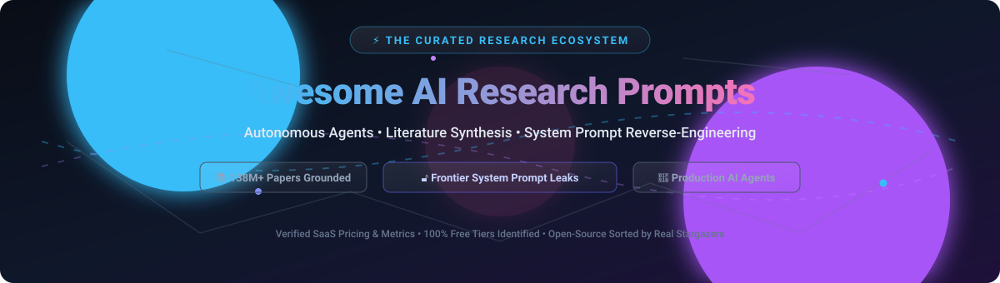

  

# 🚀 Awesome AI Research Prompts

  
  
  
  
  
  

  <strong>Curated Directory of Top AI Research Assistants, Prompt Engineering Frameworks & Open-Source Research Infrastructures</strong> 
  <em>Systematic Literature Discovery • Evidence Synthesis • Frontier System Prompt Reverse-Engineering • Citation Graphs</em>

---

## 📌 Overview

This repository is an authoritative, SEO-indexed directory tracking the **AI Research & Prompts Ecosystem**. Whether you are an academic researcher, AI engineer, data scientist, or prompt engineer, this guide indexes both high-impact **SaaS platforms** and bleeding-edge **open-source repositories**.

Key capabilities indexed here:
- 🔍 **Automated Literature Reviews:** Semantic exploration across 200M+ research papers.
- 📊 **Evidence Synthesis & Consensus:** Tabular extraction and agreement mapping from peer-reviewed publications.
- 🔓 **System Prompt Reverse-Engineering:** Production system prompts leaked or extracted from leading foundation model apps.
- 🕸️ **Citation Context & Graph Analysis:** Distinguishing supporting vs. contrasting citations and generating co-citation graphs.

---

## 📑 Table of Contents

- [📊 Sector Overview & Market Dynamics](#-sector-overview--market-dynamics)
- [🏢 SaaS & Hosted Platforms](#-saas--hosted-platforms)
- [💻 Open-Source GitHub Projects](#-open-source-github-projects)
- [📈 Star History](#-star-history)
- [💖 Support](#-support)
- [🤝 How to Contribute](#-how-to-contribute)
- [⚠️ Disclaimer](#-disclaimer)

---

## 📊 Sector Overview & Market Dynamics

The global Scientific Literature Review & AI Research software market is estimated at **$2.1 billion**, projected to expand to **$11.8 billion by 2034** at a **21.1% CAGR**. The sector remains **moderately fragmented**—featuring horizontal frontier search engines (such as Perplexity) rapidly capturing massive venture valuations at the top layer, alongside specialized, highly defensible vertical tools (evidence synthesis, citation context analysis, bibliometric graphs) competing across institutional and individual researcher workflows.

---

## 🏢 SaaS & Hosted Platforms

| Product | Valuation / Revenue | Starting Paid Price | Free Tier Limits | Description |
| :--- | :--- | :--- | :--- | :--- |
| **[Perplexity Pro](https://www.perplexity.ai/pro)** | ~$20B+ valuation (~$750M ARR) | $20/month | Free forever: Standard Quick Search queries with 5 Pro Search queries per 4 hours | Citation-first answer engine with multi-model switcher (GPT-4o, Claude, Gemini), academic filtering, and deep research synthesis. |
| **[Paperpal](https://paperpal.com/)** | ~$60M–$120M annual parent revenue (CACTUS) | $12/month (billed annually) or $29/mo | Free forever: 200 grammar edits/month, 5 AI writing/polishing actions/day, 5 research queries/day, 300 MB library | AI academic writing and submission-readiness assistant with grammar correction, paraphrase, and journal fit checks. |
| **[Elicit](https://elicit.com/)** | $100M valuation ($31M total funding) | $49/month (billed annually at $588/yr) | Free forever: Unlimited semantic paper search and abstracts, limited shared monthly usage pool for advanced agent tasks | AI research assistant automating systematic reviews, literature table extraction across 138M+ papers, and evidence synthesis. |
| **[Consensus](https://consensus.app/)** | $41.5M total funding (~$1.5M+ ARR) | $12/month (billed annually) or $20/month | Free forever: Unlimited basic searches, 10 Pro AI messages/month, 3 Deep reviews/month, 10 Study Snapshots/month | AI search engine answering queries from peer-reviewed literature with Consensus Meter agreement scores and Study Snapshots. |
| **[Iris.ai](https://iris.ai/)** | $21.6M total funding (~$3.7M ARR) | €292/month (€3,500/yr) | 10-day free trial on premium workspace plans; free basic account with exploratory document browsing | AI research workspace for systematic literature mapping, extraction, and R&D text processing across scientific publications. |
| **[Scite.ai](https://scite.ai/)** | $3.6M ARR (Acquired by Research Solutions) | $12/month (billed annually) or $20/month | 7-day free trial of full platform features; free public tallies/badge lookups | Smart citation index classifying context (supporting, contrasting, mentioning) by extracting full-text citation statements. |
| **[SciSpace](https://typeset.io/)** | ~$5M+ total funding raised | $12/month (billed annually) or $20/month | Free forever: 100 AI credits/month, 1 active concurrent task, 5 AI writer actions/doc, 5 citation exports/month | AI research platform with PDF Copilot chat, literature review extraction tables, paraphraser, and citation manager. |
| **[Semantic Scholar](https://www.semanticscholar.org/)** | Non-profit / Philanthropic (Allen Institute for AI) | 100% Free | Free forever: Full access to 200M+ research graph, Semantic Reader, TLDR summaries, and free API (1 req/sec) | Open-access academic search engine and research graph with TLDR summaries and citation impact context. |
| **[Scholarcy](https://www.scholarcy.com/)** | Bootstrapped / Privately held | $9.99/month | Free forever: 1 article summary per day via web/browser extension, max 11 MB file upload limit | AI paper summarization tool converting academic articles into interactive summary cards, key highlights, and references. |
| **[Connected Papers](https://www.connectedpapers.com/)** | Bootstrapped / Privately held | $6/month (Academic, billed annually) or $20/mo | Free forever: 5 interactive similarity graphs per month with full feature access | Visual literature mapping tool that builds interactive co-citation and bibliographic coupling graphs around origin papers. |

---

## 💻 Open-Source GitHub Projects

All open-source repositories below are sorted in descending order by GitHub stargazers. Click any badge to inspect that project's stargazers community.

| Project & Repository | Stars | Description & Key Features | License |
| :--- | :--- | :--- | :--- |
| **[Awesome ChatGPT Prompts](https://github.com/f/awesome-chatgpt-prompts)** |  | The original and most widely adopted prompt engineering collection covering conversational setups, role-play persona engineering, and model instruction patterns. | CC0-1.0 |
| **[Open-WebUI](https://github.com/open-webui/open-webui)** |  | Extensible, self-hosted AI research interface featuring integrated web search, document RAG, model orchestration, and role-based prompt management. | Porting |
| **[System Prompts and Models of AI Tools](https://github.com/x1xhlol/system-prompts-and-models-of-ai-tools)** |  | Massive repository reverse-engineering production system prompts and internal tools from Cursor, Devin, v0, Manus, Perplexity, Warp, Replit, and Google. | GPL-3.0 |
| **[RAGFlow](https://github.com/infiniflow/ragflow)** |  | Open-source deep document understanding engine and agentic RAG workflow system based on deep visual extraction for academic papers and complex PDFs. | Apache-2.0 |
| **[Prompt Engineering Guide](https://github.com/dair-ai/Prompt-Engineering-Guide)** |  | The gold-standard educational curriculum and reference guide on prompting techniques (Zero-shot, Few-shot, CoT, ReAct, Directional Stimulus, DSPy). | Apache-2.0 |
| **[Leaked System Prompts](https://github.com/asgeirtj/system_prompts_leaks)** |  | Dedicated archive of verified, extracted system prompts from leading frontier foundation models (ChatGPT, Claude 3.5 Sonnet, Gemini Pro). | Open Source |
| **[System Prompts Leaks (CL4R1T4S)](https://github.com/elder-plinius/CL4R1T4S)** |  | Comprehensive repository archiving jailbreaks, hidden prompt instructions, and reverse-engineered frontier agent configurations. | Open Source |
| **[Marker](https://github.com/datalab-to/marker)** |  | High-accuracy converter transforming research PDFs, academic formulas, tables, and books into structured Markdown and LaTeX for LLM digestion. | GPL-3.0 |
| **[Langchain-Chatchat](https://github.com/chatchat-space/Langchain-Chatchat)** |  | Local knowledge-base Q&A application powered by LangChain and local models, ideal for offline enterprise and academic paper digestion. | Apache-2.0 |
| **[STORM](https://github.com/stanford-oval/storm)** |  | Stanford University LLM system that conducts automated deep research, curates perspective outlines, searches the web, and generates Wikipedia-like synthesis reports. | MIT |
| **[GPT Researcher](https://github.com/assafelovic/gpt-researcher)** |  | Autonomous agent designed for comprehensive online research across 20+ web sources, aggregating factual citations into structured summaries. | Apache-2.0 |
| **[Zotero](https://github.com/zotero/zotero)** |  | The open-source standard for research reference management, citation collections, PDF annotations, and academic collaboration. | AGPL-3.0 |
| **[SciPy](https://github.com/scipy/scipy)** |  | Foundational scientific and numerical computing library in Python providing mathematical algorithms powering research data analysis. | BSD-3-Clause |
| **[Gorilla](https://github.com/ShishirPatil/gorilla)** |  | Berkeley open-source initiative enabling LLMs to accurately interact with massive APIs, scientific tools, and external research services. | Apache-2.0 |
| **[PaperQA](https://github.com/Future-House/paper-qa)** |  | High-accuracy RAG and question answering system over academic papers with citation extraction, hallucination mitigations, and agentic search. | Apache-2.0 |
| **[Awesome Prompts](https://github.com/ai-boost/awesome-prompts)** |  | Peer-curated directory of top-rated prompts, structured GPT instructions, and system patterns across diverse technical domains. | Open Source |
| **[R2R](https://github.com/SciPhi-AI/R2R)** |  | Semi-structured and multimodal RAG engine with native graph RAG, automatic document parsing, and observability for scientific research pipelines. | MIT |
| **[Zotero Better BibTeX](https://github.com/retorquere/zotero-better-bibtex)** |  | Essential extension for Zotero adding citation key generation and rock-solid BibTeX/BibLaTeX synchronization for LaTeX and Markdown writers. | MIT |
| **[Awesome Prompt Engineering](https://github.com/promptslab/Awesome-Prompt-Engineering)** |  | Research-oriented collection of academic papers, benchmarking datasets, and tools evaluating prompting strategies. | Open Source |
| **[HELM](https://github.com/stanford-crfm/helm)** |  | Holistic Evaluation of Language Models from Stanford CRFM—evaluating accuracy, robustness, fairness, and bias across hundreds of scenarios. | Apache-2.0 |
| **[SciSpacy](https://github.com/allenai/scispacy)** |  | Specialized spaCy models for processing biomedical, scientific, and clinical research text by the Allen Institute for AI. | Apache-2.0 |
| **[Scholarly](https://github.com/scholarly-python-package/scholarly)** |  | Python module to retrieve author profiles and citation records programmatically from Google Scholar. | MIT |
| **[Arxiv.py](https://github.com/lukasschwab/arxiv.py)** |  | Python wrapper around the arXiv API for automated paper retrieval, pre-print ingestion, and metadata harvesting. | MIT |
| **[PyPaperBot](https://github.com/ferru97/PyPaperBot)** |  | Automated Python tool to search, index, and download scientific papers and metadata across online academic databases. | MIT |
| **[ScholarPhi](https://github.com/allenai/scholarphi)** |  | AI-powered reading interface from Allen Institute for AI that surfaces inline definitions, equations, and citation context inside PDFs. | Apache-2.0 |
| **[OpenAlex Guts](https://github.com/ourresearch/openalex-guts)** |  | Core backend infrastructure and schema powering OpenAlex—the open scholarly index cataloging 250M+ scientific works. | CC0-1.0 |

---

## 📈 Star History

---

## 💖 Support

Thank you for exploring and contributing to **Awesome AI Research Prompts**! 🌟

If this repository assisted your academic research, prompt engineering experiments, or production AI builds, please consider supporting the project:

- ⭐ **Star this repository** to help fellow researchers and developers discover it.
- 🍴 **Fork and contribute** new tools, benchmarks, and prompt analyses.
- 📢 **Share with your research lab**, peers, and colleagues on Discord, X/Twitter, or LinkedIn.
- ☕ **Sponsor & Buy a Coffee:** Support ongoing maintenance, dataset updates, and server infrastructure via the [GitHub Sponsors Dashboard](https://github.com/sponsors/ishandutta2007).

---

## 🤝 How to Contribute

Contributions are warmly welcomed! We aim to keep this the most accurate and up-to-date AI research prompts directory:

1. **Fork** the repository.
2. **Add or update entries** following the table format.
3. Ensure links, starting pricing, free tier limits, and stargazer URLs are accurate and working.
4. **Submit a Pull Request** with a concise description of your additions.

---

## ⚠️ Disclaimer

- This is a **community-curated, independent directory**—inclusion does not represent formal commercial endorsement.
- Research tools handling academic papers must comply with copyright regulations and publisher terms of service.
- **System prompt reverse-engineering archives** are indexed strictly for academic analysis, AI safety research, and educational purposes. Prompts remain the intellectual property of their respective creators.
- **Always verify citation claims:** While AI research assistants drastically accelerate synthesis, always cross-reference extracted claims against original peer-reviewed source PDFs before formal scientific publication.

---

  <strong>Crafted for researchers, prompt engineers, and developers building transparent, citation-grounded AI systems.</strong>

